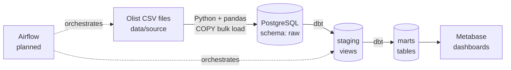

# Olist E-commerce Data Platform

An end-to-end data platform built on the [Olist Brazilian e-commerce dataset](https://www.kaggle.com/datasets/olistbr/brazilian-ecommerce). The dataset has about 100k real, anonymised marketplace orders placed between 2016 and 2018.

The project takes raw CSV exports and turns them into tested analytics tables, then into dashboards that answer business questions. The tools and layered architecture match those of a modern data team, scaled down to run on a laptop with Docker.

---

## Why this project

Olist connects small Brazilian merchants to large online marketplaces. Its data covers the whole life of an order: customer, seller, items, payment, delivery and review. That makes it a good base for questions a real e-commerce analytics team would ask:

- How do revenue and order volume change month to month?
- Which product categories and sellers drive the most revenue?
- How often are orders delivered late, and does lateness lower review scores?
- Where are customers located, and how does delivery time vary by region?
- Which payment methods and instalment plans do customers prefer?

The goal is more than answering these questions once. The platform should answer them reliably: reproducible loads, data that is versioned and tested, and a clear line from every metric back to its source rows.

---

## Architecture



Data moves through three layers:

| Layer | Schema | What it holds | Built by |
|---|---|---|---|
| **Raw** | `raw` | Exact copies of the source CSVs, every column stored as text, plus `_ingested_at` and `_source_file` columns | [ingestion/load_raw.py](ingestion/load_raw.py) |
| **Staging** | `analytics` (views) | One cleaned model per source table: renamed columns, proper types, basic tests | dbt (`models/staging`) |
| **Marts** | `analytics` (tables) | Business-ready fact and dimension tables used by dashboards | dbt (`models/marts`) |

**Why load everything as text first?** The raw layer should match the source file exactly. If a type conversion turns out to be wrong (for example, zip codes losing their leading zeros), it can be fixed in dbt without reloading anything.

---

## Tech stack

| Purpose | Tool |
|---|---|
| Warehouse | PostgreSQL 16 (Docker) |
| Ingestion | Python 3.12, pandas, SQLAlchemy, psycopg2 (Postgres `COPY` for bulk loads) |
| Transformation and testing | dbt (dbt-postgres) |
| BI and dashboards | Metabase (Docker) |
| Orchestration | Apache Airflow *(planned)* |
| Environment and dependencies | uv, Docker Compose |
| Code quality | ruff, sqlfluff, pre-commit, pytest |

---

## Project structure

```
olist-ecommerce-data-platform/
├── data/
│   ├── source/            # Olist CSV files (git-ignored)
│   └── daily/             # Daily data drops for incremental loads (planned)
├── ingestion/
│   └── load_raw.py        # Loads the CSVs into the raw schema
├── dbt/
│   ├── dbt_project.yml
│   ├── profiles.yml
│   └── models/
│       ├── staging/       # stg_* models, sources and tests
│       └── marts/         # fact and dimension tables (in progress)
├── dags/                  # Airflow DAGs (planned)
├── tests/                 # Python tests
├── docs/                  # Diagrams and extra documentation
├── docker-compose.yml     # Postgres + Metabase
├── pyproject.toml         # Python dependencies (uv)
└── .env                   # Local credentials (git-ignored)
```

---

## Getting started

### Prerequisites

- [Docker Desktop](https://www.docker.com/products/docker-desktop/)
- [uv](https://docs.astral.sh/uv/)
- The Olist dataset from [Kaggle](https://www.kaggle.com/datasets/olistbr/brazilian-ecommerce)

### 1. Clone and install dependencies

```bash
git clone <repo-url>
cd olist-ecommerce-data-platform
uv sync
```

### 2. Configure the environment

Create a `.env` file in the project root:

```env
POSTGRES_USER=warehouse
POSTGRES_PASSWORD=change-me
POSTGRES_DB=olist
POSTGRES_PORT=5433
```

### 3. Add the data

Download the dataset from Kaggle and put the 9 CSV files in `data/source/`.

### 4. Start the services

```bash
docker compose up -d
```

| Service | URL |
|---|---|
| PostgreSQL | `localhost:5433` |
| Metabase | http://localhost:3000 |

### 5. Load the raw data

```bash
uv run python ingestion/load_raw.py
```

This creates the `raw` schema and loads every CSV into it, about 1.5M rows in total.

### 6. Build and test the dbt models

```bash
cd dbt
uv run dbt debug --profiles-dir .   # check the connection
uv run dbt build --profiles-dir .   # run the models and tests
```

---

## Data quality

dbt tests check the data at the staging layer, for example:

- `order_id` is **unique** and **not null** in `stg_orders`
- `order_status` contains only the 8 known statuses (`delivered`, `shipped`, `canceled`, ...)

More tests (relationships between tables, value ranges, freshness) will be added with the marts.

---

## Roadmap

- [x] Dockerised Postgres warehouse and Metabase
- [x] Raw ingestion of all Olist CSVs with load metadata
- [x] dbt project with sources and a first staging model (`stg_orders`)
- [ ] Staging models for all source tables
- [ ] Star schema marts: `fct_orders`, `fct_order_items`, `dim_customers`, `dim_products`, `dim_sellers`, `dim_date`
- [ ] Metabase dashboards for sales, delivery performance and customer satisfaction
- [ ] Incremental loads from simulated daily data drops (`data/daily`)
- [ ] Airflow DAG to run ingestion and dbt end to end
- [ ] CI pipeline running ruff, sqlfluff, pytest and `dbt build`

---

## Dataset

The data comes from Olist, published on Kaggle as [Brazilian E-Commerce Public Dataset by Olist](https://www.kaggle.com/datasets/olistbr/brazilian-ecommerce) under the CC BY-NC-SA 4.0 license. It is not stored in this repository.
